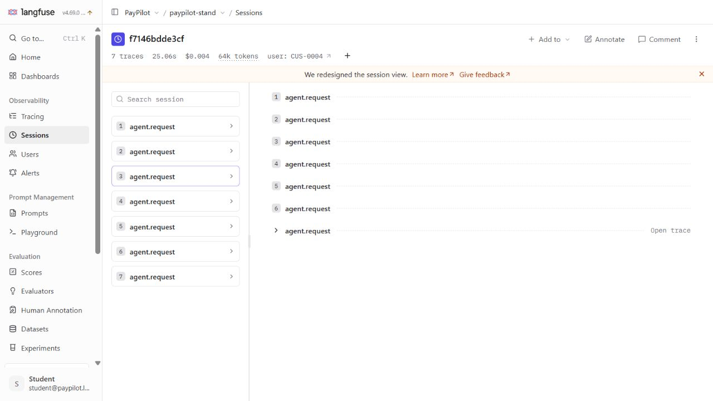

# Observability & Cost Report · PayPilot

Вимірювання 27–28.10.2026 (Europe/Kyiv), clock 2026-09-15. Стенд 74f1995; L03 7d0f5e7; L08 666e496; Langfuse 4.69.0. OpenRouter: Haiku 5.5 / Gemini 2.5 Flash, по 5 повторів B3/B4 на умову. Daily budget: 1 повтор, release: 5. [Версії](../evidence/provenance.json), [прайс](../evidence/model-prices-api.json), [облік cache-write](pilot-and-price-review.md).

Прайс USD/млн токенів (input/output/cache-read/write): Haiku 0.10/0.50/0.01/0.125; Gemini 0.30/2.50/0.03/0.113333 (effective write).

## Слайд 1 · Трейс проти лічильника

Сесія f7146bdde3cf: 7 кроків, USD 0.00445066; [Total Cost](screenshots/c07-total-cost-column.png) округлює до 0.004451. Скриншот — повтор 1, таблиці — медіани 5. [Експорт](../evidence/langfuse/session-f7146bdde3cf.json).

| Сліпа зона | Що пропущено | Джерело перевірки |
|---|---|---|
| usage.cost_usd за D14 | Приховані повтори моделі; 8 однакових get_transactions | Provider cost і всі llm.call spans |
| Langfuse без model definition | Ціна Haiku відсутня на старих сесіях | [Сесії, записані до definition](screenshots/sessions-before-haiku-pricing.png) |
| Лише input/output prices | Cache buckets без ціни занижують суму | [Повне визначення](screenshots/haiku-model-definition.png), usage breakdown |
| llm.call sum / root usage | Summary generation не включена | agent.summarize usage + provider total |

Лише input/output prices дали б USD 0.00340920: різницю до USD 0.00445066 пояснюють cache buckets. Reasoning high не перевірявся.

**Інцидент B3, lesson-05/summarize_after=2, repeat 2:**

| Крок | Спан | Що записано | Де розійшлося |
|---|---|---|---|
| 1–2 | tool results / llm.call | TX-0401 і duplicate_charge присутні в історії | Ще є у вході summary |
| **3** | **agent.summarize** | **summary.input: TX-0401/duplicate_charge; summary.text: без них, service_not_rendered** | **Втрата на виході стиснення** |
| 4 | llm.call / tools | tool.get_account, tool.get_transactions | Повторне отримання контексту після втрати |

**Вхід генерації на кроці розбіжності:** summary.input містив TX-0401/duplicate_charge; summary.text — без обох.

Для регулятора: крок 3, agent.summarize — втрачено TX-0401 і підмінено reason code. Перевірка summary: clean 5/5, defect 0/5. [Дослівний доказ і розподіл](incident-summary.md).

**Ціна з трьох джерел, медіана USD/діалог (Haiku):**

| Сценарій | Умова | usage.cost_usd | Сума llm.call за прайсом | Provider cost |
|---|---|---|---|---|
| B1 | clean | 0.000349 | 0.000348 | 0.000348 |
| B1 | clean+D14 | 0.000484 | 0.001852 | 0.001852 |
| B2 | clean | 0.004160 | 0.004161 | 0.004161 |
| B2 | lesson-08 | 0.006192 | 0.006192 | 0.006192 |

| B2 · медіани | Clean | Lesson-08 |
|---|---|---|
| Input tokens | 57053 | 76634 |
| Час, мс | 22895 | 24762 |
| USD/діалог | 0.004161 | 0.006192 |

B2 lesson-08/clean: input **1.34×**, час **1.08×**, ціна **1.49×**. D15 додає context replay. [Крива токенів](screenshots/b2-token-curve.png).

## Слайд 2 · Прогноз

| Поверх | Значення | Джерело |
|---|---|---|
| Крок | B2 clean, крок 2: USD 0.000740 (медіана 5) | Реальні spans, [B4](b4.json) |
| Діалог | B2 clean USD 0.004161; lesson-08 USD 0.006192 | Медіани 5 |
| Місяць | 800 активних користувачів ×20 діалогів; mix 30% B1/70% B2 | 800 із завдання; частота й mix — явні планові припущення |
| anthropic/claude-haiku-5.5 | USD 48.27/місяць; C(N)=N×20×0.0030171 | Виміряний clean mix, без hosting/fixed costs |
| google/gemini-2.5-flash | USD 60.23/місяць; C(N)=N×20×0.0037646 | Виміряний clean mix, без hosting/fixed costs |

**Що росте швидше за N:** перечитування історії може давати T² за довжиною діалогу. За фіксованих довжини й міксу витрати лінійні в N. [Припущення](planning-assumptions.json).

[Чотири гіпотези](forecast-before-runs.md) закомічено до оплати; [звірка прогнозу](forecast-review.md) зберігає початкові очікування й результати.

## Слайд 3 · Рішення

| Важіль | Що дає | Що псується |
|---|---|---|
| Ліміт однакових tool calls | Зупиняє D14-петлю | Може блокувати обґрунтований повтор після тимчасової помилки |
| Контроль context replay / бюджет токенів | Зменшує зайвий вхід D15 | Надто тісний поріг відхиляє законний довгий діалог |
| Стиснення історії | Обмежує контекст | B3 показує втрату сутностей і повторні tools; потрібен summary invariant |
| Зміна моделі | Може зменшити час | Інші tokenizer/поведінка, старі пороги не переносні |

**Що обміняли:** швидкість Gemini на дешевші діалоги Haiku. **Чого не робимо:** не трактуємо cost PASS як якість. **Умова перегляду:** потреба меншої затримки або новий прайс; спочатку перекалібрувати бюджети й перевірити зміст.

### Міграція моделі

| Модель | Сценарій/умова | USD: медіана (min–max) | Час, с: медіана (min–max) | Перевірки |
|---|---|---|---|---|
| Gemini | B1/clean | 0.000518 (0.000498–0.000555) | 3.0 (2.8–3.6) | 5/5 |
| Gemini | B1/D14 | 0.001870 (0.001846–0.004103) | 8.3 (7.8–14.3) | 0/5 |
| Gemini | B2/clean | 0.005156 (0.004906–0.005298) | 11.3 (10.5–11.4) | PASS |
| Gemini | B2/lesson-08 | 0.007002 (0.006837–0.008821) | 10.2 (9.8–12.5) | PASS |
| Haiku | B1/clean | 0.000348 (0.000329–0.000369) | 4.7 (4.6–4.8) | 5/5 |
| Haiku | B1/D14 | 0.001852 (0.001786–0.001875) | 18.6 (18.4–19.9) | 0/5 |
| Haiku | B2/clean | 0.004161 (0.003949–0.004823) | 22.9 (22.6–25.9) | PASS |
| Haiku | B2/lesson-08 | 0.006192 (0.005164–0.006922) | 24.8 (23.2–26.1) | FAIL |

- **Рішення:** лишаємо Haiku — дешевший в обох clean-сценаріях; Gemini швидший.
- **Що зелене:** B1 tool/precondition+duplicate check 5/5 clean на обох; B2 clean aggregate PASS. D14 виявлено 5/5 обома.
- **Чого перевірки не бачать:** правильність reason/window у B3, повноту відповідей B2 і доречність create_dispute на кроці 2 C-07; ці відповіді передаємо судді на L09, [межі](measurement-scope.md).
- **Пороги перезняти:** tokens_total, latency_ms release-кейсів і first-call-input B2: поріг 6500 на Gemini пропускає defect. Токени різних tokenizer не порівнюємо.

**Бюджети в кейсах:** [sets/l05_dialogs.jsonl](../sets/l05_dialogs.jsonl): BUD-H01/H02/H04/D15 — release/5; BUD-D14/READ — daily/1. [Reports](../reports), [метод](measurement-scope.md).

Фінальна перевірка Docker V2: clean **6/6**, lesson-08 **2/6 PASS**. Чотири FAIL — бюджетні порушення. [Вердикти по кейсах](../evidence/docker-clean-clone.json).

Поріг H04 V2 зменшує ризик false positive, але пропускає D15; H01/H02/BUD-D15 його виявляють. [Хронологія та вибірки](budget-calibration-notes.md).

У короткому B3 контроль без summary дешевший за summary2; довгі діалоги не вимірювалися. [Медіани й межі висновку](forecast-review.md).

### Калібрування tokens_total · BUD-D15

| Варіант | Поріг | Clean median/verdict | Lesson-08 median/verdict |
|---|---|---|---|
| Занадто вільний | 52787 | 44884 / PASS | 52242 / PASS |
| Занадто тісний | 43999 | 44884 / FAIL | 52242 / FAIL |
| Обраний | 47252 | 44884 / PASS | 52242 / FAIL |

Вільний/тісний пороги переоцінено на збережених captures. Обраний зафіксовано до фінальних прогонів: +5% до незалежної clean-медіани. [Метод](calibration-rule-update.md), [вибірки](../evidence/budget-calibration.json).

**Залишковий ризик:** latency містить instrumentation, місячний мікс — припущення, вибірка — 5 повторів. Зміна моделі/оточення потребує калібрування; production hosting і L09 ще не виміряні. [Межі](measurement-scope.md).

**Фактичні витрати:** 946 chat-відповідей, 173 сесії, **USD 0.590454076**. Кабінет OpenRouter 28.10.2026 показує накопичені USD 0.6290: точний usage 0.629046806 мінус 0.03859273 до ДЗ7. Збіг до точності кабінету; округлені модельні суми не є розбивкою лише ДЗ7. [Звірка](../evidence/billing-reconciliation.json), [покажчик серій](run-index.md).
